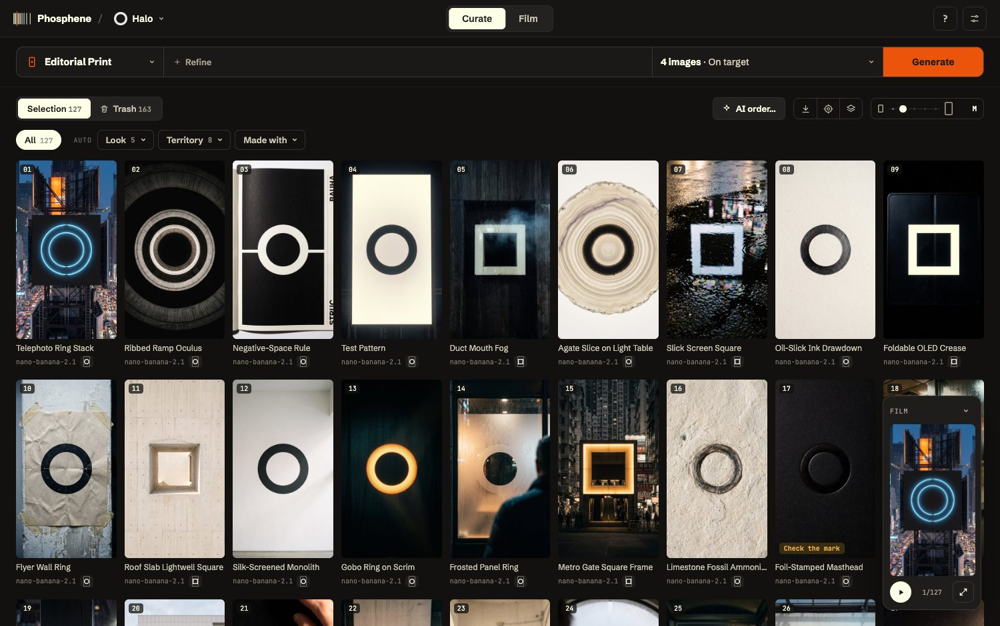
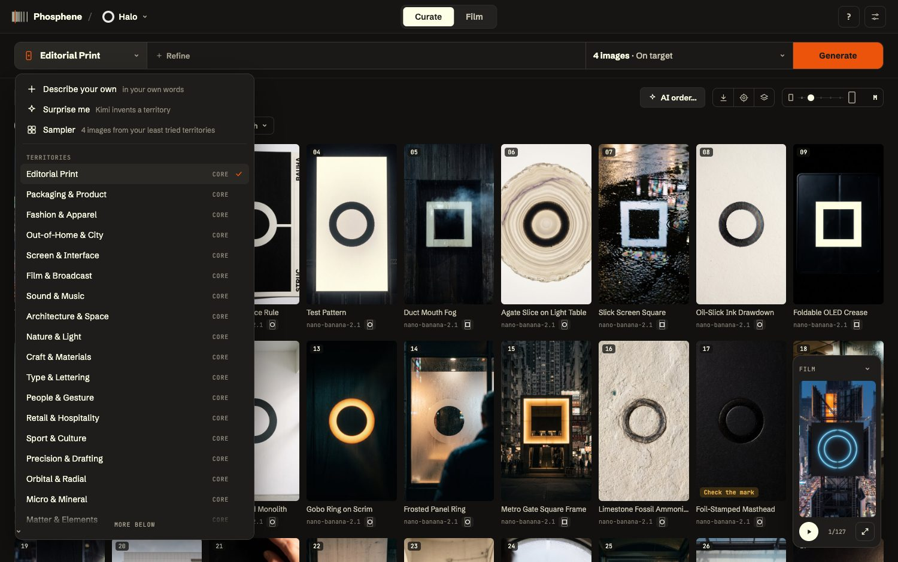
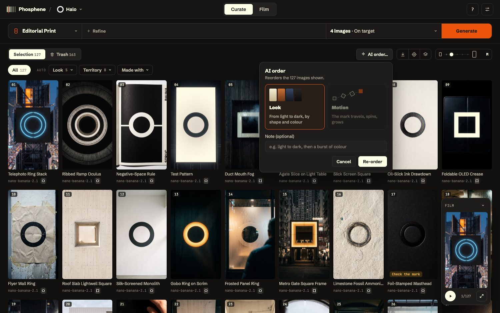
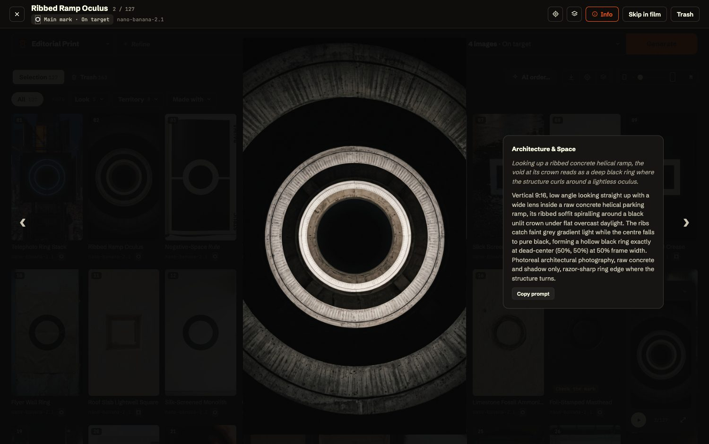
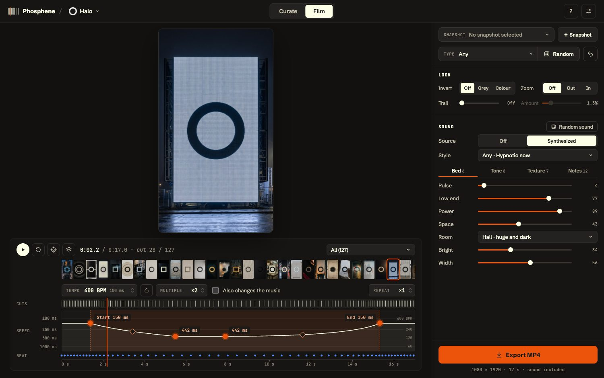
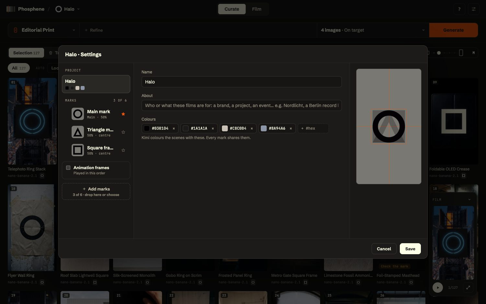
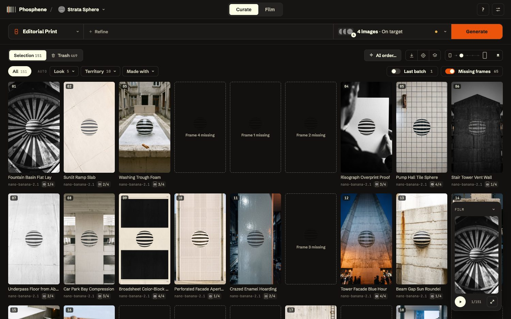

# Phosphene

Makes 9:16 match-cut films around a brand mark: AI images where the mark always sits at the same place and size, cut to a
synthesized drone. Curate the images, cut the film, export an MP4.

It runs on your own computer. You sign in with your own Krea account (images use its credits) and your own Kimi key
(it writes the image ideas).



## What it does

**Curate** — make and choose the images.
- Pick a **territory** (Editorial Print, Packaging, Out-of-Home…), or *Describe your own*, *Surprise me*, or a *Sampler* across
  territories; *Refine* narrows it. **Generate** asks Kimi for scene ideas and Krea for the images, with the mark drawn into a guide
  at its exact place and size (**On target**), close to it (**Loose**) or anywhere (**Scattered**).
- Every new image is **checked for the mark** (right place, right size): clear misses go to the Trash, doubtful ones get a badge.
- Keep or trash by hand; the app learns from it (the taste loop steers the next prompts and models).
- **Groups**: your own, and automatic ones by look, territory, mark, position and source. **Add images** (or drop them) mixes your
  own photos in. **AI order…** rearranges the selection like an editor (contrast cuts, shape echoes, colour hand-offs, an energy arc,
  and where each mark sits); a note steers it.

| Territories | AI order | The image viewer (with its prompt) |
|---|---|---|
|  |  |  |

**Film** — cut the images to a rhythm and a sound, and export.



- **The timeline is the rhythm**: a tempo, a Multiple (picture cuts per music cut), Repeat, and **points of speed** — click the line to
  add one, drag it, shape each change with its handle — so a film can slow down and speed up again.
- **Look**: inverted copies (grey or colour), a slow zoom in or out per cut, a trail.
- **Sound**: a synthesized score made in the page (WebAudio), in a **style** — Drone (the dark bed measured from the reference
  films), Hypnotic (minimal, on a grid that follows the speed) or Run (a running bass) — with its bed, tone, textures and notes.
  **Random** rolls a whole film inside a **Type** (Landing, Build, Pulse, Machine…), **Random sound** a new sound for the same cut.
- **Snapshots** keep ways of cutting the same curation; **Export MP4** renders 1080 × 1920 with the sound, in the page.

**Projects** — one per mark. A project can hold several marks (a symbol, a wordmark, a badge), each with its own place and size and
the words the prompts use for it; colours belong to the project. Projects travel as `.phos` files (Export / Import project…).

| Project settings | Frames of one animation |
|---|---|
|  |  |

## The Mac app (easiest)

Download **Phosphene.dmg** from the link you were sent, open it and drag Phosphene into Applications.
The first time, macOS says it cannot verify the developer (the app is not notarized by Apple yet): click **Done**, then System Settings ›
**Privacy & Security**, scroll to "Phosphene was blocked", **Open Anyway**, and your password. Only once. After that it opens normally,
and it updates itself: when a new version is out it says so, and **Restart to update** installs it.

- Your projects are in **Documents › Phosphene**, one folder each. Updates never touch them, and deleting the app leaves them.
  Back them up like any document. The app starts with none: make one (New project…) or open a project file you were sent
  (double-click it, or Import project…).
- To send a project to someone: the project menu (next to Phosphene) › **Export project…**; they use **Import project…**.
- Needs a Mac with Apple silicon (M1 or newer).

## Install from the code (for developers)

You need a Mac (or Linux) with [Homebrew](https://brew.sh), and Git.

```sh
git clone <this repository> phosphene
cd phosphene
npm run setup        # checks Python 3.10+, Node 20+ and ffmpeg (offers to install what is missing),
                     # and installs the app's packages
```

If `npm` itself is missing: `brew install node`, then run the line again.

## Run

```sh
npm run dev
```

Then open http://localhost:5173. Stop it with Ctrl-C.

The first time:
1. **Settings** (the sliders icon, top right) › **Connect Krea**: sign in to Krea in the tab that opens, then come back.
2. In the same Settings, paste your **Kimi API key** and save.

## Projects

A project is one brand mark. The name next to **Phosphene** (top left) switches between them.

- **New project…** takes your mark (a PNG or SVG with a transparent background works best), its size and place in the frame,
  how the image prompts should describe it, one line about the brand, and its colours. A new project stays on your computer
  (`projects/<name>/`, not committed).

## Update

```sh
git pull
npm run setup        # only needed when packages changed; safe to run any time
```

## For developers

`AGENTS.md` describes how everything works, in detail and with the reasons behind each choice: read it before changing anything.

**How it is built**

| Part | Where | What |
|---|---|---|
| The page | `studio/web/` (`index.html`, `src/app.js`, `src/style.css`) | Vite, plain JavaScript. Curate, Film, the timeline, Random. |
| The sound | `studio/web/src/drone.js` | WebAudio: the same graph plays live and renders the export offline. |
| The picture | `studio/web/src/render.js` | WebGL2: the same renderer draws the preview and every exported frame. |
| The server | `studio/server.py` | Python, no framework: the JSON API, the plates, generation, the logo check, encoding (ffmpeg). |
| Projects | `studio/projects.py`, `studio/placement.py` | Marks, places and sizes, guides, `.phos` files. |
| Images | `studio/krea_mcp_client.py` | Krea over MCP (OAuth sign-in), the prompts written by Kimi. |
| Mark check | `studio/qa_engine.py` | Is the mark at its place and size? (`npm run qa:replay` checks it against your own keeps and trashes.) |
| AI order | `studio/editor.py`, `studio/features.py` | Kimi's editing brief, then a deterministic search for the order. |
| The Mac app | `app/` | Tauri 2: a native window around the same page and a frozen server; updates from GitHub. |

**Tests** (no network, no credits, never your real data):

```sh
npm test                                                  # the page, in node with a fake DOM (~10 s)
.venv/bin/python -m pytest studio/tests -q                # the server, and the browser tests below (~4 min)
node --test studio/tests/e2e/*.e2e.test.cjs              # the real page in headless Chrome against a fake API
```

Run the tests of what you change while you work, the fast suite before each commit (`--ignore=studio/tests/test_e2e.py`), and
everything before a release. Screenshots of a test run: `E2E_SHOTS=/some/folder`. The screenshots above were taken from a copy of
the projects on a separate server.

## Releasing the Mac app

```sh
npm run release 0.1.1     # builds, signs and publishes to github.com/thelau/phosphene-releases
```

The automatic tests (`.venv/bin/python -m pytest studio/tests -q`, `npm test`, `node --test studio/tests/e2e/*.e2e.test.cjs`) cover
the page and the server. They cannot reach the Mac app's own shell, where several bugs were only found by hand, so before
publishing, open the built app (`app/src-tauri/target/release/bundle/macos/Phosphene.app`) and check, about 5 minutes:

- [ ] **Signed as a whole**: `codesign --verify --deep --strict app/src-tauri/target/release/bundle/macos/Phosphene.app` says nothing (an error there means a downloaded copy reads as "damaged").
- [ ] **It opens**, on the last project, with the Phosphene icon in the Dock and in ⌘Tab; About Phosphene shows the new version.
- [ ] **Menu bar**: File › New Project (⌘N) opens the form; File › Open Project File… (⌘O) opens the macOS file dialog; Project ›
      Import project… opens the same dialog; Export project… saves a `.phos` file to Downloads.
- [ ] **A `.phos` file double-clicked in Finder** opens as a project.
- [ ] **Settings › Connect Krea** opens Krea's sign-in in your browser and comes back connected.
- [ ] **Generate** a small batch (2 images): they arrive with the mark check's badges.
- [ ] **Drag a card** to another place in Curate: it moves (the window's file-drop handler used to take every drag).
- [ ] **Fastest cuts**: Film, the tempo at the top with Multiple ×1, sound on, play for 20 s: no visible hiccups (in headless WebKit ~2% of
      cuts last two refreshes instead of one; Chrome none; the test cannot tell whether the real window does).
- [ ] **Sound**: Film › play: the drone plays. Put Phosphene behind other windows for 5 minutes, come back: it still plays.
- [ ] **Export** a short film: "Downloaded", and the MP4 in Downloads plays (not a tiny broken file).
- [ ] **⌘Q while generating** asks "Quit anyway / Keep working"; reopening offers to Resume the images not made.
- [ ] **Full screen** and back: the window's red / yellow / green buttons sit right in the top bar.
- [ ] **Update** (from the previous version installed): the "Restart to update" bar appears and the app comes back as the new version.

Keep the update signing key (`~/.tauri/phosphene.key`) backed up: without it, installed apps can never update again.

## License

MIT, see [LICENSE](LICENSE). The Mac app also bundles FFmpeg (GPL-2.0) and fonts under the OFL: their licences are in `app/licenses/`.
